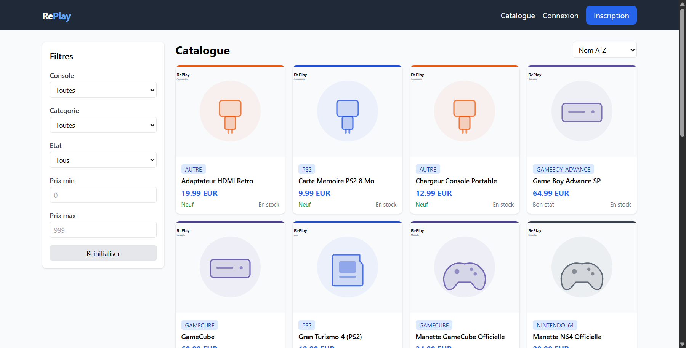
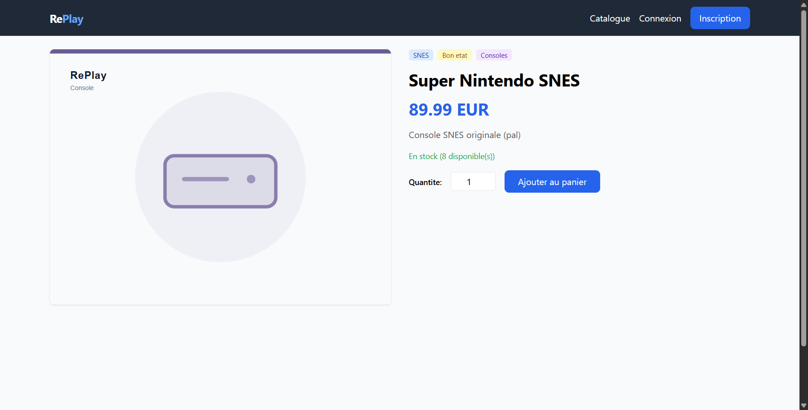
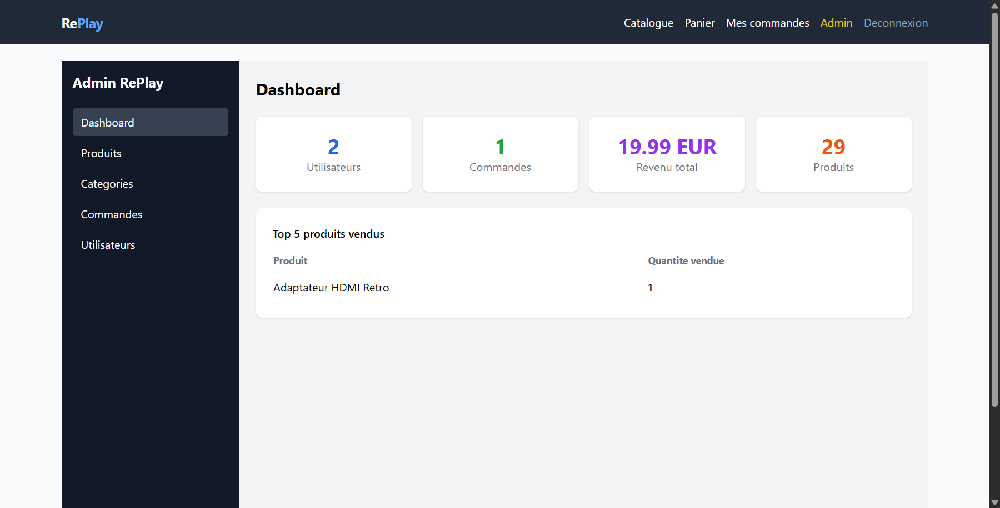
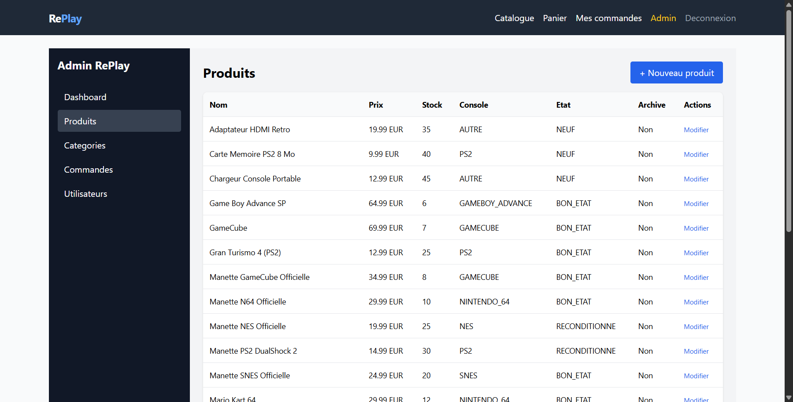

# RePlay

Full-stack e-commerce platform for retro-gaming collectors.
Spring Boot 3.4, Angular 18, PostgreSQL 16, Docker and GitHub Actions.

[](https://github.com/russell-sedj/RePlay/actions/workflows/ci.yml)

## Screenshots

| Catalogue | Product detail |
| --- | --- |
|  |  |

| Admin dashboard | Admin products |
| --- | --- |
|  |  |

The UI is in French (the target audience is French retro-gaming collectors); this documentation is in English. Screenshots come from a local run with the seed data and one test order.

## Stack

- **Backend**: Java 17, Spring Boot 3.4.4, Spring Security 6 (JWT), Spring Data JPA / Hibernate, PostgreSQL 16, H2 for tests, Lombok, SpringDoc OpenAPI.
- **Frontend**: Angular 18, TypeScript, Tailwind CSS.
- **Infrastructure**: Docker multi-stage builds, Docker Compose, GitHub Actions (tests, production build, multi-arch images for `amd64` and `arm64`).

## Features

- **Authentication**: 15-minute access token, 7-day refresh token rotated on every refresh and stored server-side so it can be revoked; BCrypt password hashing.
- **Catalogue**: pagination, sorting, and filters by category, console, condition and price range.
- **Cart**: one persistent cart per user, with stock validation on add and update.
- **Orders**: price snapshot on every order line, order history, status lifecycle (`PENDING`, `CONFIRMED`, `SHIPPED`, `DELIVERED`, `CANCELLED`).
- **Payment**: mock payment with a generated transaction ID and stock decrement at confirmation.
- **Admin**: dashboard statistics, product and category CRUD, order status management, user list.
- **API documentation**: Swagger UI at `/swagger-ui.html`.
- **Seed data**: 2 users, 5 categories, 29 products.

## Architecture

```text
backend/
  src/main/java/com/replay/
    admin/      admin endpoints and DTOs
    auth/       user, roles, authentication, JWT
    cart/       persistent cart and stock validation
    common/     project exceptions and global error handling
    config/     security, JWT, OpenAPI, seed data
    order/      order creation with price snapshots
    payment/    mock payment and stock decrement
    product/    catalogue, JPA Specifications, categories

frontend/
  src/app/
    admin/      lazy-loaded admin module
    auth/       login and register
    cart/       cart page
    checkout/   checkout flow
    core/       auth service, guards, HTTP interceptor
    order/      order history and detail
    products/   catalogue, product detail, API service
```

The backend exposes a stateless REST API secured by JWT. The Angular SPA talks to it through an HTTP interceptor that adds the access token to API requests. PostgreSQL is the production database; H2 keeps the test suite fast and self-contained.

## Quick start

### Full stack with Docker

```bash
docker compose -f docker-compose.prod.yml up -d --build
```

- Storefront: <http://localhost>
- API: <http://localhost:8080>
- Swagger UI: <http://localhost:8080/swagger-ui.html>

Demo accounts (seed data, for local use only):

| Role | Email | Password |
| --- | --- | --- |
| Admin | `admin@replay.fr` | `admin123` |
| User | `user@replay.fr` | `user123` |

> Change these credentials and the JWT secrets before any public deployment.

### Development mode

```bash
docker compose up -d                 # PostgreSQL and pgAdmin
cd backend && mvn spring-boot:run    # API on :8080
cd frontend && npm ci && npm start   # SPA on :4200, proxy /api to :8080
```

- Frontend: <http://localhost:4200>
- pgAdmin: <http://localhost:5050>

## Tests and CI

The backend has **36 JUnit 5 / Mockito tests** covering authentication, catalogue filters, cart, orders and payment.

```bash
cd backend && mvn test
```

Without a local JDK or Maven:

```bash
docker run --rm -v "$(pwd)/backend:/app" -w /app maven:3.9-eclipse-temurin-17 mvn test
```

On every push and pull request, the GitHub Actions workflow runs the backend tests and a production frontend build. On `main`, it also builds and pushes multi-arch Docker images (`linux/amd64`, `linux/arm64`) to the GitHub Container Registry.

## Key decisions

1. **Price snapshot at order time.** `OrderItem.unitPrice` stores the price at checkout. A product price change must not rewrite an order: an order is a historical record. The trade-off is intentional denormalization.
2. **JPA Specifications for catalogue filters.** Filters are composable and type-safe, and adding a filter does not multiply repository methods. The trade-off is a little more code than derived queries.
3. **Access and refresh tokens are split.** The access token is short-lived; the refresh token is rotated on every refresh and stored server-side so it can be revoked. The trade-off is an extra database write and a more complex client, but a stolen access token has a small blast radius.
4. **Multi-stage, multi-arch Docker images.** The runtime images contain no Maven or Node, and the same image runs on `amd64` and on the ARM64 Oracle Cloud free tier. The trade-off is a slower CI pipeline.

## Limits and next steps

This is a portfolio project, not a production system. The main gaps are explicit:

- **Mock payment**: no Stripe, no webhooks, no idempotency keys. Next step: Stripe sandbox with signed webhooks and an idempotency key on payment creation.
- **Tokens in `localStorage`**: exposed to XSS. Next step: refresh token in an `httpOnly`, `Secure`, `SameSite` cookie, access token kept in memory, and CSRF protection.
- **Stock check and decrement are not atomic** under concurrency: two simultaneous payments can oversell. Next step: optimistic locking (`@Version`) or a conditional `UPDATE ... WHERE stock >= quantity`, plus stock reservation at order creation.
- **Tests run on H2, production runs on PostgreSQL**: a dialect-drift risk. Next step: Testcontainers with the same PostgreSQL version.
- **The frontend does not auto-refresh the access token yet**: the API supports refresh-token rotation, but the interceptor only attaches the access token. Next step: a 401 retry flow that calls `/api/auth/refresh` once and replays the request.
- **No logout endpoint yet**: the frontend clears the tokens, but the refresh token remains valid until expiry. Next step: `POST /api/auth/logout` that revokes the stored refresh token.

## Deployment

The repository includes a production Docker Compose stack and an Oracle Cloud Free Tier (ARM64, Ampere A1) guide in [`deploy/deploy.md`](deploy/deploy.md). The project is not publicly deployed; the quick start above runs the full stack locally.
